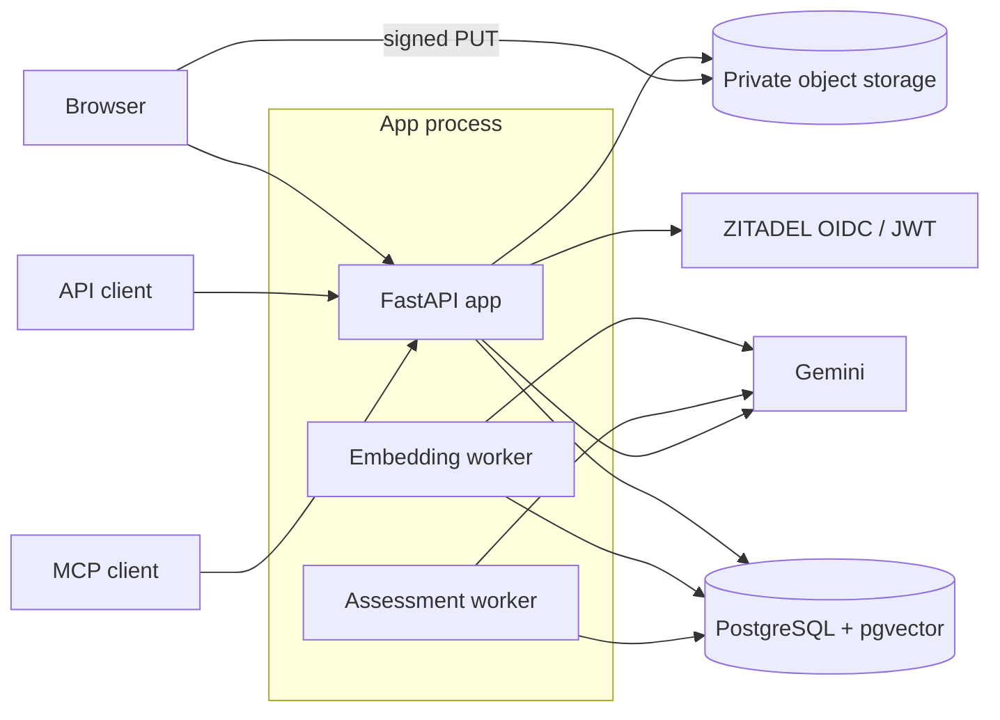

# Vendor Risk Analyzer

Vendor Risk Analyzer turns a vendor's security and compliance documents into an
evidence-grounded risk assessment. Analysts upload policies, questionnaires, and
reports; the application parses and embeds them, retrieves evidence across nine
risk categories, asks a language model to identify contradictions, evidence gaps,
and explicit risks that must cite the retrieved text, and then rates every finding
with deterministic policy rules. Users can also chat with a vendor's documents and
receive answers with source citations.

It is a FastAPI application backed by PostgreSQL with pgvector, private
S3-compatible object storage, Gemini models, and ZITADEL for sign-in. A browser UI
(Jinja2 and plain JavaScript), a JSON API, and an optional authenticated
Model Context Protocol (MCP) server share the same services and access rules.

## Contents

- [Features](#features)
- [Architecture](#architecture)
- [How an assessment works](#how-an-assessment-works)
- [Documents, chunking, and retrieval](#documents-chunking-and-retrieval)
- [Chat](#chat)
- [Companies, roles, and access](#companies-roles-and-access)
- [Security controls](#security-controls)
- [Audit trail](#audit-trail)
- [AI usage](#ai-usage)
- [Quality evaluation](#quality-evaluation)
- [Data model](#data-model)
- [Project structure](#project-structure)
- [Local setup](#local-setup)
- [Configuration reference](#configuration-reference)
- [API reference](#api-reference)
- [MCP tools](#mcp-tools)
- [Tests and CI](#tests-and-ci)
- [Deployment and operations](#deployment-and-operations)
- [Limitations](#limitations)
- [Further documentation](#further-documentation)

## Features

**Documents**
- Parsers for PDF, DOCX, XLSX, CSV, plain text, and Markdown (25 MB limit)
- Direct-to-storage uploads with signed URLs; size and SHA-256 are verified before parsing
- Structure-aware chunks that keep heading context and treat tables as their own units
- Background embedding worker that batches chunks per Gemini request
- Live status on the Documents page until processing finishes

**Assessments**
- Retrieval across nine risk categories with per-category coverage reporting
- Model findings must cite retrieved chunk IDs; invalid citations are repaired or dropped
- Deterministic policy rules assign severity, overall risk, and a 0–100 risk score
- Assessments run in the background with a live progress view
- Reports download as PDF or Word

**Chat**
- Vendor-scoped questions answered with numbered source citations
- Conversations saved per user and vendor, with server-side history

**Access and operations**
- Multi-company access mapped to ZITADEL organizations, with Viewer, Analyst, and Admin roles
- Per-user vendor assignments managed by company admins
- Company audit log, security headers, and per-user rate limits on Gemini usage
- Gemini token usage per company on the admin System page, with optional cost estimates
- Optional Sentry error tracking with vendor content kept out
- Optional JWT bearer access for API clients and six authenticated MCP tools
- A repeatable quality evaluation with labelled fixture vendors

## Architecture



One application process serves the web pages, the JSON API, and the optional MCP
endpoint, and runs two background workers:

- **Embedding worker:** embeds chunks of newly processed documents.
- **Assessment worker:** runs queued assessments.

Both workers claim work from PostgreSQL with `FOR UPDATE SKIP LOCKED`, so several
replicas can run safely. ZITADEL and Gemini are external services; Docker Compose
provides PostgreSQL and MinIO for local development.

## How an assessment works

1. **Queue.** An Analyst or Admin starts an assessment. The API records it as
   `queued` and returns HTTP 202 immediately.
2. **Claim.** The assessment worker claims it (`running`) and stores progress that
   the report page polls and displays.
3. **Retrieve.** One semantic query per category searches the vendor's `ready`
   documents. Repeated hits are merged and tagged with every topic that found them.
4. **Analyze.** The model receives the evidence (treated as untrusted data) and
   returns schema-constrained output: a summary, findings, and a coverage judgement
   for each category.
5. **Ground.** Duplicate citations are collapsed, chunk IDs that were not retrieved
   are removed, and findings left without valid evidence are dropped and counted.
   A strict validator then checks the result.
6. **Consolidate.** Duplicate findings are merged deterministically: identical
   findings, an evidence gap and an explicit risk about the same issue, and a
   contradiction about a stated risk (the risk is kept and notes that the sources
   disagree), so one issue is not counted twice in the score. The summary is
   rebuilt whenever the finding set changed.
7. **Save and rate.** Findings are persisted with their evidence, then the policy
   assigns severities, the overall risk, and the score. The assessment becomes
   `completed`, or `failed` with a user-safe message.

The database connection is released while the model call runs, and the call is
bounded by `RISK_LLM_TIMEOUT_SECONDS`. An assessment interrupted by shutdown returns
to the queue. One that stops making progress for `ASSESSMENT_STALE_MINUTES` is
marked failed rather than retried automatically.

### Finding types and categories

| Finding type | Meaning |
| --- | --- |
| `contradiction` | Two retrieved sources disagree about the same control (needs at least two chunks) |
| `evidence_gap` | The source states that required evidence is missing, incomplete, or not provided |
| `explicit_risk` | The source describes a risk or open issue, or states a known risky practice |

Risky practices are reported even when a document states them neutrally. These are:

- customer data used to train AI models by default or unless customers opt out
- required controls, such as MFA, not enforced for some users
- customer data sold or shared beyond providing the service

The nine assessed categories are access control, encryption, incident response,
vulnerability management, privacy, business continuity, data retention, third
parties, and AI governance. `other` is allowed for findings outside these.

### Severity, risk score, and coverage

The model identifies findings; it never assigns severity. Policy
`vendor-risk-policy-v3` rates every finding-type and category combination.

| Category | Explicit risk | Contradiction | Evidence gap |
| --- | --- | --- | --- |
| Access control, encryption, incident response, vulnerability management, privacy | high | medium | medium |
| Business continuity | medium | medium | medium |
| Data retention, third party, AI governance | medium | medium | low |
| Other | low | low | low |

Rules never assign `critical`; that needs analyst judgement. The overall risk is
the highest finding severity.

The **risk score** (0–100, higher is riskier) combines finding weights with
diminishing returns:

```
score = 100 × (1 − ∏(1 − w))     w: low 0.05 · medium 0.15 · high 0.30 · critical 0.50
```

One high finding scores 30, two score 51, and no number of findings exceeds 100.

**Coverage** records, for each category, whether the evidence was:

- `assessed`
- `insufficient_evidence`
- `no_evidence` (nothing was retrieved)
- `not_reported` (the model omitted it)

The report shows the coverage percentage beside the score, so a category without
findings is not mistaken for a strong control.

Re-rate saved assessments after a policy change with the
[`apply_risk_policy` task](scripts/README.md#apply-the-deterministic-risk-policy).

## Documents, chunking, and retrieval

### Upload and processing

1. **Upload.** The browser requests a signed URL and uploads the file straight to
   private storage, then confirms the upload.
2. **Verify.** Processing checks the stored object's size before downloading it,
   then verifies its SHA-256 against the value recorded at upload. A replaced or
   oversized object is marked `failed` and never parsed.
3. **Retry if interrupted.** Re-requesting an upload that never finished returns a
   fresh URL for the same document, rather than a duplicate error.

Processing statuses:

- `upload_pending` → `uploaded` → `processing` → `embedding_pending` → `embedding` → `ready`
- `failed` or `embedding_failed` on errors

Starting processing is a single conditional update, so double clicks cannot run it
twice. A document left in `processing` for more than 15 minutes can be retried.
Parsing runs in a worker thread, so it does not block other requests.

### Chunking

Chunks keep heading context, keep tables as separate units with their structural
metadata, and skip navigation-only content. Text chunks target 1,200 characters,
with one overlapping source element and 160 characters of overlap when an element
is split.

### Embeddings

The embedding worker claims documents in `embedding_pending` and sends up to
`EMBEDDING_WORKER_BATCH_SIZE` chunks per Gemini request, pausing
`EMBEDDING_WORKER_DELAY_SECONDS` between requests. If a model does not return one
vector per input, the worker falls back to one request per chunk. Vectors are
768-dimensional and verified after saving. Interrupted documents are recovered
after `EMBEDDING_WORKER_STALE_MINUTES`. The admin **System** page shows whether the
worker is running, disabled, or stopped (and why).

### Retrieval

Queries are embedded with the same model and searched with pgvector cosine
distance over an HNSW index. Search is restricted to:

- the selected vendor
- documents in `ready` status
- chunks embedded with the active model and dimension

On pgvector 0.8 or later, relaxed iterative HNSW scans keep filtered vendor
searches returning full results as the shared table grows.

Changing `EMBEDDING_MODEL` requires re-embedding stored chunks. Changing
`EMBEDDING_DIMENSIONS` also requires a schema migration.

## Chat

Analysts and Admins can ask questions about one vendor at a time. Chat retrieves up
to five chunks and answers only from them, with `[S1]`-style citations. Citation
checks reject missing or out-of-range markers, and the model retries once. When the
evidence does not answer the question, chat says so instead of guessing.

Web conversations are saved per user and vendor and listed beside the chat:

- **Private:** only the person who created a conversation can see it, and only
  while they still have access to the vendor.
- **Server-side history:** a continued conversation loads its last six messages
  from the database. History sent by the browser is ignored, so it cannot be
  tampered with.
- **Answers come first:** if saving fails, the answer is still returned.

The MCP `ask_vendor` tool is stateless.

## Companies, roles, and access

Each company in the app maps to one registered ZITADEL organization. Roles come
from this project's ZITADEL role claim and apply only within the organization that
granted them.

| Role | Access |
| --- | --- |
| `viewer` | Read vendors, documents, assessments, and reports; download exports |
| `analyst` | Viewer access plus vendor creation, uploads and processing, assessments, and AI chat |
| `admin` | Analyst access plus company user access (`/admin/access`), the audit log (`/admin/audit`), and system status (`/admin/system`) |
| No role | Public sign-in and access-information screens only |

Company admins give each user either all company vendors or assigned vendors only.
New users follow the company default. Every page, API endpoint, export, and MCP
tool enforces the same company and vendor rules. Unknown, foreign, and unassigned
IDs all return the same not-found response.

Browser sign-in uses Authorization Code with PKCE. The app validates the ID token
and the matching UserInfo subject before creating a signed session. Provider tokens
are never stored in the session. Cookie-authenticated writes require a CSRF token;
verified bearer requests do not. After a role change, users sign out and in again.

See [Company and vendor access](docs/company-access.md) for registering companies.

## Security controls

- **Content Security Policy:** same-origin scripts and styles only. The storage
  endpoint (for uploads) and the ZITADEL issuer (for sign-in) are the only external
  origins.
- **Other headers:** `X-Content-Type-Options`, `X-Frame-Options: DENY`,
  `Referrer-Policy`, and `Permissions-Policy`, plus HSTS when secure cookies are on.
- **Rate limits:** per user and company on Gemini-backed requests.
  `ASSESSMENT_RATE_LIMIT_PER_HOUR` (default 20) covers new assessments;
  `CHAT_RATE_LIMIT_PER_MINUTE` (default 20) covers chat and MCP `ask_vendor`.
  Over the limit, requests return 429 with `Retry-After`. Limits are stored in
  PostgreSQL and shared by every app instance: a burst up to the limit is allowed,
  then requests refill evenly across the window (GCRA). If the database is
  unreachable, each process falls back to its own in-memory count. Requests
  rejected for authentication or CSRF use no quota.
- **Prompt-injection guard:** document content is passed to the model as untrusted
  data, with instructions never to follow text found inside evidence.
- **Container:** the image runs as a non-root user with a pinned `uv` version.
- **API docs:** public Swagger, ReDoc, and OpenAPI endpoints are disabled.

## Audit trail

Company admins can review who did what at `/admin/audit` (or
`GET /api/admin/audit`), limited to their company. Recorded actions:

- vendor creation
- document upload, confirmation, and processing
- assessment requests, completion, failure, and exports
- AI chat questions, length only, never the text
- conversation deletion
- company switching
- user access changes, with previous values, and default-access changes

Events are written after the action succeeds, on their own short database session.
A failed audit write is logged but never blocks the user. Events are kept
indefinitely.

## AI usage

Every assessment and chat answer records the Gemini tokens it used (input,
output, and thinking tokens, and the number of model calls) in
`llm_usage_events`. Tokens are counted even when an answer is later rejected,
for example an assessment that fails grounding or a chat reply retried for
missing citations, because they were still spent. A completed assessment also
stores its usage in the report metadata (`llm_usage`).

Admins see the last 30 days for their company on the **System** page, by
feature and model. Gemini's free tier is not billed, so only token counts are
shown unless `LLM_INPUT_PRICE_PER_MILLION_TOKENS` and
`LLM_OUTPUT_PRICE_PER_MILLION_TOKENS` are set; then an estimated cost at those
rates is added. Embedding calls are not counted.

## Quality evaluation

`evals/fixtures/` contains documents for two fictional vendors with planted issues:

- **Larkspur Data Systems:** six issues, including contradictions between a policy
  and a questionnaire, open pentest findings, and missing evidence
- **Brightwater Cloud Storage:** two issues, an outdated incident plan and AI
  training on customer files by default

`src/vendor_risk_analyzer/evaluation/cases.json` lists, for each case:

- the findings each assessment should produce (category, acceptable types, keywords)
- the categories that must stay free of findings
- the expected coverage and overall risk

To run it:

1. Create one vendor per case and upload its fixture documents.
2. Wait until the documents are `ready`.
3. Run the utility job with these settings:

```dotenv
OPS_TASK=run_eval
OPS_EVAL_CASES=larkspur=<vendor-uuid>,brightwater=<vendor-uuid>
OPS_EVAL_RUNS=3
```

The evaluation runs real retrieval, the configured model, and the policy rules
without saving anything. Each actual finding can satisfy at most one expectation.
It reports, per run and summarized across runs:

- recall
- false positives in clean categories
- coverage mismatches
- overall-risk agreement
- each planted issue's detection rate

It exits non-zero unless every run passes. Run it before and after changing
prompts, retrieval, or models. Make sure the job uses the same `RISK_LLM_MODEL`
and `EMBEDDING_MODEL` as the application, otherwise it measures a different model.

## Data model

| Table | Holds |
| --- | --- |
| `tenants`, `tenant_memberships`, `vendor_assignments` | Companies, their members' access mode, and per-user vendor assignments |
| `vendors` | Vendor identity and company |
| `documents` | Uploaded file metadata, object key, SHA-256, and processing status |
| `document_elements` | Parsed paragraphs, headings, and tables with page/sheet context |
| `document_chunks` | Retrieval chunks with a 768-dimensional `embedding` (HNSW cosine index) |
| `assessments`, `findings` | Reports with status, progress, coverage, score, and rated findings with evidence |
| `chat_conversations`, `chat_messages` | Saved chat conversations and their messages and sources |
| `audit_events` | Company audit trail |
| `rate_limit_buckets` | Shared per-user rate-limit state (one row per user and limit) |
| `llm_usage_events` | Gemini tokens per assessment or chat answer, per company |

Original files stay in the private bucket. Re-processing a document replaces its
elements and chunks, and the embedding worker re-embeds them.

## Project structure

| Path | Responsibility |
| --- | --- |
| [src/vendor_risk_analyzer/api/](src/vendor_risk_analyzer/api/) | JSON API routes: vendors, documents, assessments and exports, chat, access, audit, health |
| [src/vendor_risk_analyzer/auth/](src/vendor_risk_analyzer/auth/) | OIDC login, sessions, roles, CSRF, JWT verification, company access |
| [src/vendor_risk_analyzer/ingestion/](src/vendor_risk_analyzer/ingestion/) | File parsers, structural elements, chunking, integrity checks |
| [src/vendor_risk_analyzer/embeddings/](src/vendor_risk_analyzer/embeddings/) | Gemini embeddings (batched), embedding worker, persistence helpers |
| [src/vendor_risk_analyzer/retrieval/](src/vendor_risk_analyzer/retrieval/) | Vendor-scoped pgvector search |
| [src/vendor_risk_analyzer/risk_analysis/](src/vendor_risk_analyzer/risk_analysis/) | Prompt, structured analysis, grounding repair, consolidation, coverage |
| [src/vendor_risk_analyzer/risk_policy/](src/vendor_risk_analyzer/risk_policy/) | Severity rules, overall risk, risk score |
| [src/vendor_risk_analyzer/assessments/](src/vendor_risk_analyzer/assessments/) | Assessment persistence, background worker, report export |
| [src/vendor_risk_analyzer/chat/](src/vendor_risk_analyzer/chat/) | Grounded chat and saved conversations |
| [src/vendor_risk_analyzer/audit/](src/vendor_risk_analyzer/audit/) | Audit event recording and listing |
| [src/vendor_risk_analyzer/usage/](src/vendor_risk_analyzer/usage/) | Gemini token counts, usage recording, and cost estimates |
| [src/vendor_risk_analyzer/evaluation/](src/vendor_risk_analyzer/evaluation/) | Evaluation cases and scoring |
| [src/vendor_risk_analyzer/mcp/](src/vendor_risk_analyzer/mcp/) | Authenticated Streamable HTTP MCP tools |
| [src/vendor_risk_analyzer/db/](src/vendor_risk_analyzer/db/), [storage/](src/vendor_risk_analyzer/storage/) | SQLAlchemy models and sessions; private object storage |
| `security_headers.py`, `rate_limit.py`, `config.py` | Response headers, rate limiting, validated settings |
| [src/vendor_risk_analyzer/web/](src/vendor_risk_analyzer/web/), [templates/](src/vendor_risk_analyzer/templates/), [static/](src/vendor_risk_analyzer/static/) | Browser pages, navigation, templates, CSS, and JavaScript |
| [migrations/](migrations/) | Alembic migrations |
| [scripts/](scripts/) | Local storage setup, operational tasks, live smoke checks |
| [evals/fixtures/](evals/fixtures/) | Documents for the quality evaluation |
| [tests/](tests/), [tests/security/](tests/security/) | Unit, regression, and HTTP security tests |
| [docs/](docs/) | Local development, company access, API authentication, MCP |

## Local setup

### Prerequisites

- Git, and Docker Desktop (or Docker Engine with Compose v2)
- A ZITADEL project and OIDC application for sign-in
- A Gemini API key
- uv and Python 3.12, only if running Python outside Docker

### 1. Settings

```bash
git clone https://github.com/bhuwanbkt/vendor-risk-analyzer.git
cd vendor-risk-analyzer
cp .env.example .env
```

Only `.env.example` is tracked; `.env` stays out of git and the Docker build.
Generate a session secret and paste it into `SESSION_SECRET`:

```bash
python3 -c "import secrets; print(secrets.token_hex(32))"
```

### 2. ZITADEL

Create a development application using Authorization Code with S256 PKCE and
authentication method `none`; the app sends no client secret. Enable Development
mode and register:

- Callback: `http://localhost:8000/auth/callback`
- After logout: `http://localhost:8000/`

Then:

1. Fill in `ZITADEL_ISSUER`, `ZITADEL_CLIENT_ID`, and `ZITADEL_PROJECT_ID`.
2. Create the lowercase project roles `viewer`, `analyst`, and `admin`.
3. Enable **Assert Roles on Authentication**.
4. Assign a role to each user.

### 3. Gemini

Set `GEMINI_API_KEY`, `EMBEDDING_MODEL`, and `RISK_LLM_MODEL` to models available to
your account, keep `EMBEDDING_DIMENSIONS=768`, and set
`EMBEDDING_WORKER_ENABLED=true`. Without the worker, documents stay in
`embedding_pending`.

### 4. Start with Docker Compose

```bash
docker compose --env-file .env up --build -d
docker compose --env-file .env logs -f app
```

| Service | Role | Local address |
| --- | --- | --- |
| `app` | FastAPI and both workers | http://localhost:8000 (`/health`, `/ready`) |
| `db` | PostgreSQL with pgvector | localhost:5433 |
| `minio` | Private S3-compatible storage | http://localhost:9000, console :9001 |
| `migrate` | Applies migrations, then exits | — |
| `storage-init` | Creates the private bucket, then exits | — |

Use `--env-file .env` on every Compose command. Ports bind to loopback; use
`localhost` consistently. The first build compiles MinIO from source and takes a
few minutes.

Stop the stack without losing data:

```bash
docker compose --env-file .env down
```

### 5. Register your company

Before signing in to vendor data, bind the workspace to your ZITADEL organization
using the steps in [company access](docs/company-access.md#register-the-initial-company).

### Run Python directly (optional)

Set `SESSION_COOKIE_SECURE=false` for HTTP localhost, then:

```bash
docker compose --env-file .env up -d db minio
docker compose --env-file .env run --rm storage-init
uv sync --python 3.12 --frozen --no-dev
uv run --python 3.12 python -m dotenv -f .env run -- alembic upgrade head
uv run --python 3.12 uvicorn vendor_risk_analyzer.main:app --host 127.0.0.1 --port 8000 --env-file .env
```

See [Local development](docs/local-development.md) for port changes, volumes, and
pip compatibility.

## Configuration reference

**Core**

| Setting | Default | Purpose |
| --- | --- | --- |
| `APP_ENV` | `development` | Use `production` when hosted |
| `DATABASE_URL` | — | PostgreSQL connection |
| `DATABASE_POOL_SIZE`, `DATABASE_MAX_OVERFLOW` | `2`, `1` | Web request connection pool |
| `SESSION_SECRET` | — | Signs session cookies |
| `SESSION_COOKIE_SECURE` | `true` | `false` only for HTTP localhost in development |

**Identity**

| Setting | Default | Purpose |
| --- | --- | --- |
| `ZITADEL_ISSUER`, `ZITADEL_CLIENT_ID`, `ZITADEL_PROJECT_ID` | — | Identity provider, application, and project |
| `ZITADEL_REDIRECT_URI`, `ZITADEL_POST_LOGOUT_URI` | — | Registered callback and logout URLs |
| `API_BEARER_ENABLED` | `false` | Accept JWT access tokens on the API |
| `MCP_ENABLED`, `MCP_PUBLIC_URL` | `false` | Enable MCP; needs bearer auth and the exact public `/mcp` URL |

**Object storage**

| Setting | Default | Purpose |
| --- | --- | --- |
| `OBJECT_STORAGE_ENDPOINT`, `OBJECT_STORAGE_PUBLIC_ENDPOINT` | — | Storage endpoint, and the browser-facing endpoint if different |
| `OBJECT_STORAGE_REGION`, `OBJECT_STORAGE_BUCKET`, `OBJECT_STORAGE_ADDRESSING_STYLE` | —, `vendor-documents`, `auto` | Region, bucket, and URL style |
| `OBJECT_STORAGE_ACCESS_KEY_ID`, `OBJECT_STORAGE_SECRET_ACCESS_KEY` | — | Storage credentials |

**Models**

| Setting | Default | Purpose |
| --- | --- | --- |
| `GEMINI_API_KEY` | — | Gemini access |
| `EMBEDDING_MODEL`, `EMBEDDING_DIMENSIONS` | —, `768` | Embedding model and vector size |
| `RISK_LLM_MODEL`, `CHAT_LLM_MODEL` | — | Assessment model; optional chat override |
| `RISK_LLM_TIMEOUT_SECONDS`, `RISK_RETRIEVAL_LIMIT` | `120`, `6` | Analysis call limit; chunks per category query |

**Workers and limits**

| Setting | Default | Purpose |
| --- | --- | --- |
| `EMBEDDING_WORKER_ENABLED` | `true` | Run the embedding worker |
| `EMBEDDING_WORKER_BATCH_SIZE`, `EMBEDDING_WORKER_DELAY_SECONDS` | `20`, `4` | Chunks per request; pause between requests |
| `EMBEDDING_WORKER_POLL_SECONDS`, `EMBEDDING_WORKER_STALE_MINUTES` | `10`, `30` | Polling and stale recovery |
| `ASSESSMENT_WORKER_ENABLED` | `true` | Run the assessment worker |
| `ASSESSMENT_WORKER_POLL_SECONDS`, `ASSESSMENT_STALE_MINUTES` | `5`, `15` | Polling; when a stuck run is failed |
| `EMBEDDING_WORKER_IDLE_MAX_SECONDS`, `ASSESSMENT_WORKER_IDLE_MAX_SECONDS` | `600`, `600` | Longest wait between checks of an empty queue (see below) |
| `ASSESSMENT_RATE_LIMIT_PER_HOUR`, `CHAT_RATE_LIMIT_PER_MINUTE` | `20`, `20` | Per-user limits (`0` disables) |
| `RATE_LIMIT_BACKEND` | `database` | `database` shares limits across instances; `memory` keeps them per process |

**Monitoring**

| Setting | Default | Purpose |
| --- | --- | --- |
| `SENTRY_DSN` | — | Turn on Sentry error tracking (off when unset) |
| `SENTRY_ENVIRONMENT` | `APP_ENV` | Environment name shown in Sentry |
| `SENTRY_TRACES_SAMPLE_RATE` | `0` | Share of requests traced for performance (0–1) |
| `LLM_INPUT_PRICE_PER_MILLION_TOKENS`, `LLM_OUTPUT_PRICE_PER_MILLION_TOKENS` | — | USD prices for the System page's cost estimate (both required; thinking tokens count as output) |

Keep `RISK_LLM_MODEL` and `EMBEDDING_MODEL` identical on the application and on
any job that runs analysis or evaluation.

**Idle backoff.** When a worker's queue is empty, the wait between database checks
doubles from the poll interval up to the idle maximum. Finding work resets it, and
an upload or a new assessment wakes the worker immediately, so users never wait
for the backoff. The 10-minute default is longer than Neon's 5-minute idle window,
so a serverless database can suspend instead of being kept awake by polling. Set
the maximum equal to the poll interval to turn backoff off.

## API reference

| Method | Endpoint | Purpose |
| --- | --- | --- |
| GET | `/health`, `/ready` | Liveness and database readiness (public) |
| GET | `/auth/me` | Current identity and company grants |
| GET / POST | `/api/vendors` | List or create vendors |
| GET | `/api/vendors/{vendor_id}/documents` | List a vendor's documents |
| POST | `/api/vendors/{vendor_id}/documents/upload-url` | Request a signed upload URL |
| POST | `/api/vendors/{vendor_id}/documents/{document_id}/complete` | Confirm an upload |
| POST | `/api/vendors/{vendor_id}/documents/{document_id}/ingest` | Start processing |
| POST | `/api/vendors/{vendor_id}/assessments` | Queue an assessment (202) |
| GET | `/api/assessments/{assessment_id}` | Read an assessment; poll until `completed` or `failed` |
| GET | `/api/assessments/{assessment_id}/export?format=pdf\|docx` | Download a completed report |
| POST | `/api/chat` | Ask a question; include `conversation_id` to continue a saved chat |
| GET | `/api/chat/conversations?vendor_id=` | List your saved conversations |
| GET / DELETE | `/api/chat/conversations/{conversation_id}` | Open or delete one of your conversations |
| GET / POST / PUT | `/api/admin/access/...` | Company user access (admin) |
| GET | `/api/admin/audit` | Company audit events (admin) |

Browser sessions authenticate the API. External clients can use ZITADEL JWT access
tokens when `API_BEARER_ENABLED=true`; send `X-Organization-ID` when the token
grants roles in several organizations. See [API authentication](docs/api-authentication.md).

## MCP tools

An optional Streamable HTTP server at `/mcp` exposes six tools. Every request needs
a verified ZITADEL JWT access token, browser cookies are rejected, and every tool
checks the caller's role and vendor access.

| Tool | Purpose | Roles |
| --- | --- | --- |
| `list_vendors` | List vendors with pagination | Viewer, Analyst, Admin |
| `get_vendor` | Read one vendor | Viewer, Analyst, Admin |
| `list_vendor_documents` | List document metadata | Viewer, Analyst, Admin |
| `list_vendor_assessments` | List saved assessments | Viewer, Analyst, Admin |
| `get_assessment` | Read one report | Viewer, Analyst, Admin |
| `ask_vendor` | Ask a grounded question (rate-limited, audited, not saved) | Analyst, Admin |

See [MCP setup and client examples](docs/mcp.md).

## Tests and CI

```bash
uv sync --python 3.12 --frozen --no-dev
uv run --python 3.12 --with pytest pytest -q
```

The suite (about 650 tests) covers:

- parsing and chunking
- grounding repair and consolidation
- policy rules and scoring
- background jobs, exports, and saved chat
- the audit trail and evaluation scoring
- OIDC login and logout, roles, CSRF, and bearer tokens
- company isolation and vendor boundaries
- security headers and rate limits
- the real MCP transport

External providers are mocked. Tests must not depend on a local `.env`, because CI
has none.

[GitHub Actions CI](.github/workflows/ci.yml) runs two jobs on every pull request
and push to `main`:

| Job | Checks |
| --- | --- |
| `quality-and-tests` | Locked dependency sync, requirements export check, compilation, full test suite with coverage |
| `local-runtime` | Docker build; real PostgreSQL migrations from an older revision with data preserved; schema compared with the models; private MinIO uploads, downloads, and processing; MCP discovery and rejection checks; pip install check |

CI never contacts ZITADEL or Gemini. Live model quality is measured with the
[quality evaluation](#quality-evaluation). Retrieval against a real vendor can be
checked with the manual [Integration Smoke](.github/workflows/integration-smoke.yml)
workflow, which needs `DATABASE_URL` and `GEMINI_API_KEY` repository secrets.

## Deployment and operations

The [Dockerfile](Dockerfile) runs the app on `PORT` (default 8000) as a non-root
user. When hosted, use:

- `APP_ENV=production`
- HTTPS callback and logout URLs registered in ZITADEL
- a unique `SESSION_SECRET`
- `SESSION_COOKIE_SECURE=true`

The reference deployment (Northflank) uses one application service and two jobs
built from the same image:

| Job | Command | Use |
| --- | --- | --- |
| Migration | `uv run alembic upgrade head` | Apply schema migrations |
| Utility | `uv run python scripts/ops/run.py` | `register_tenant`, `apply_risk_policy`, `backfill_embeddings`, `run_eval` (chosen with `OPS_TASK`) |

**Releases that add a migration:** merge, build the migration job from the new
`main`, and run it as soon as the new app deploys. Additive tables (audit, chat)
fail gracefully until then. For a migration the running app depends on, pause
continuous deployment, run the migration first, then deploy.

Check the applied revision with `SELECT version_num FROM alembic_version;`. See
[Operational scripts](scripts/README.md) for every utility task.

**Health checks:** point the platform's frequent liveness check at `/health`,
which does not touch the database. `/ready` runs a query, so polling it every few
seconds keeps a serverless database from ever suspending.

**Error tracking:** set `SENTRY_DSN` to report unhandled request errors and every
worker failure (workers log failures with `logger.exception`, which Sentry
captures). Sentry's free Developer plan is enough for one project. Vendor content
is kept out: request bodies, cookies, auth and CSRF headers, client IPs, stack
frame variables, and Gemini prompts/answers are never sent, and performance
tracing is off unless `SENTRY_TRACES_SAMPLE_RATE` is raised.

## Limitations

- ZITADEL and Gemini are required; the full application cannot run offline.
- The model is not fully deterministic. On the evaluation fixtures, findings and
  scores have been identical across repeated runs, but real vendor documents,
  model updates, or prompt changes can still produce different findings and scores
  between runs. Use the quality evaluation's detection rates rather than single
  runs to judge changes.
- Severities and score weights are document-based defaults, not calibrated against
  real incidents.
- Citation checks validate references, not every factual claim in generated text.
- Companies are registered by an operator; team or group assignments are not implemented.

## Further documentation

- [Local development and pip compatibility](docs/local-development.md)
- [Company registration and vendor access](docs/company-access.md)
- [API bearer authentication](docs/api-authentication.md)
- [MCP tools and client setup](docs/mcp.md)
- [Operational scripts](scripts/README.md)
- [Security tests and their limits](tests/security/README.md)
